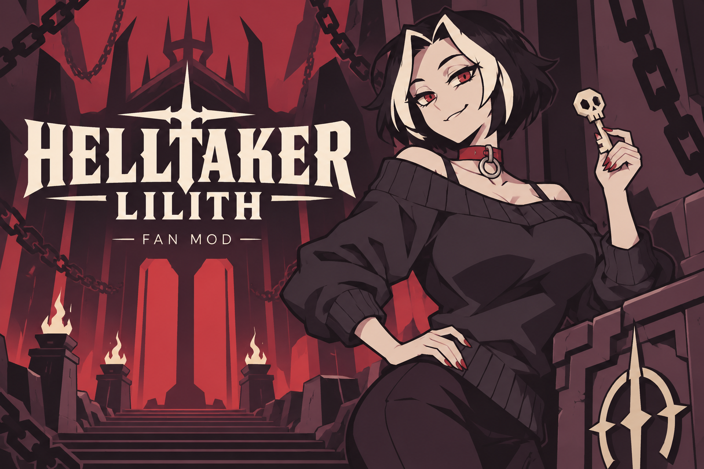
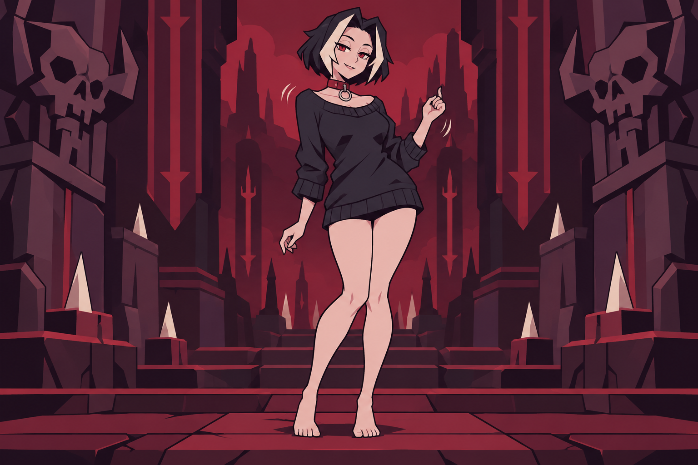
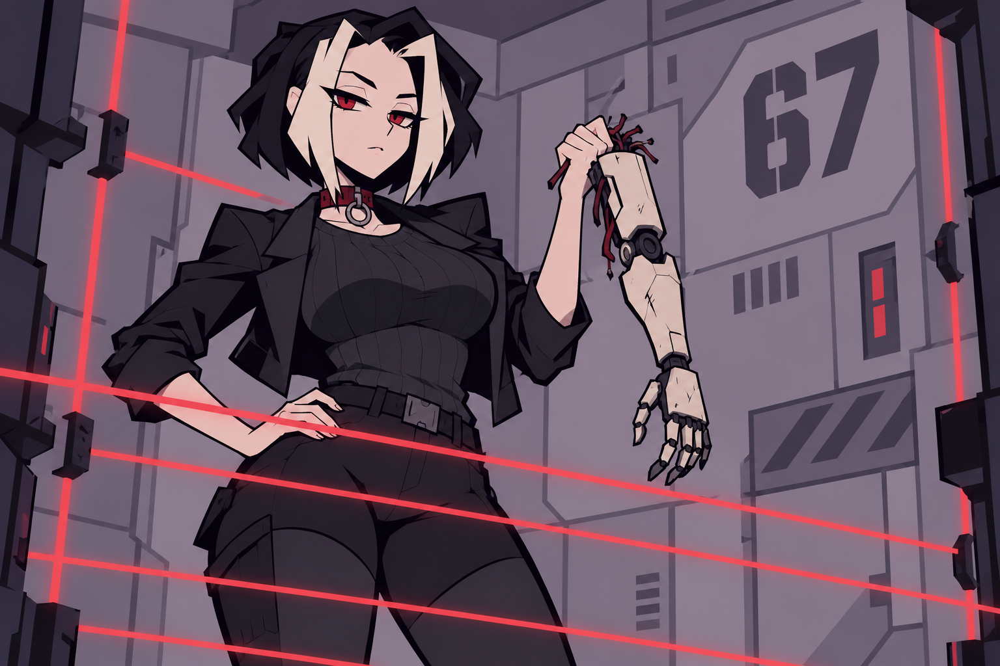

  

<h1 align="center">Helltaker · Лилит</h1>

<strong>Своя героиня. Свой ритм. История на русском.</strong>

  
  
  
  

  <a href="https://github.com/RosTGs/helltaker-lilith/releases/latest"><strong>Скачать мод</strong></a> ·
  <a href="docs/INSTALLATION.md">Установка</a> ·
  <a href="docs/GALLERY.md">Галерея</a> ·
  <a href="docs/VISUAL_PACKS.md">Свои визуалы</a> ·
  <a href="docs/AI_INTERFACE.md">AI Lab</a>

Лилит отправляется в ад: чёрное каре со светлыми прядями, красный чокер и спокойная уверенность перед очередной головоломкой. Фанатский мод заменяет главного героя взрослой девушкой, адаптирует русские реплики под её историю и связывает танцевальную стойку с музыкой игры.

| Героиня | Ритм | История |
|---|---|---|
| 113 текстур: спрайты, портреты, сюжетные арты | 12 фаз танца, три варианта внешности | Основная игра и Examtaker на русском |
| Свои PNG через пакеты внешности | Опора стоп и фаза музыкальной композиции | 47 файлов и 586 адаптированных строк |

## Мир Лилит

Три новые иллюстрации для страницы проекта: путешествие, домашняя передышка и испытание. Обложка и галерея созданы специально для оформления репозитория; игровые текстуры поставляются в каталогах `packs`.

<table>
  <tr>
    <td width="33%"></td>
    <td width="33%"></td>
    <td width="33%"></td>
  </tr>
  <tr>
    <td><strong>Две доли в аду</strong> Пружинящие колени, лёгкий жест и музыка между ходами.</td>
    <td><strong>Завтрак после ада</strong> Фартук, кофе и блины — домашняя сторона приключения.</td>
    <td><strong>Испытуемая 67</strong> Лазеры, лаборатория и собственный взгляд на правила.</td>
  </tr>
</table>

[Открыть галерею с описаниями →](docs/GALLERY.md)

## Что входит

- 113 текстур Лилит: игровой персонаж, фартук, Examtaker, диалоговые портреты и сюжетные арты.
- 12 фаз танцевальной стойки для каждого из трёх вариантов. Стопы сохраняют опору, музыка задаёт фазу движения.
- Сохранённый вариант спокойного дыхания и переключение на исходную графику.
- Русский текст основной игры и Examtaker: 47 файлов, 586 строк с сохранением индексов диалогов. Реплики, имя и обращения адаптированы под Лилит.
- Шрифт Georgia с кириллицей; резервные шрифты — Times New Roman и Arial из Windows.
- Локальный интерфейс для наблюдений, действий агента, снимков игры и обучения.

## Быстрый старт

1. Подготовьте отдельную копию своей установленной Helltaker, например `C:/Games/Helltaker-Lilith`.
2. Распакуйте **BepInEx 5.4.23.6 для Windows x64** в эту копию рядом с `Helltaker.exe`. [Официальная загрузка](https://github.com/BepInEx/BepInEx/releases/tag/v5.4.23.6).
3. Скачайте архив `Helltaker-Lilith-v0.2.0.zip` из раздела Releases и распакуйте в ту же папку с объединением каталогов.
4. Запустите Steam под владельцем игры, затем откройте `Play-Lilith.cmd` в подготовленной копии.

По умолчанию включены танец Лилит и русский текст. Для игры достаточно готового архива. Исходники и Python-клиент нужны для разработки и экспериментов с агентами.

## Управление пакетом

| Команда в папке игры | Результат |
|---|---|
| `Play-Lilith.cmd` | Запуск в окне 1280×720 |
| `Use-Dance.cmd` | Танцевальная стойка |
| `Use-Breathing.cmd` | Спокойная стойка с дыханием |
| `Use-Original-Visuals.cmd` | Исходная графика игры |
| `Use-Russian.cmd` | Русская история Лилит после перезапуска |
| `Use-Original-Text.cmd` | Исходный текст после перезапуска |
| F8 в игре | Применение выбранного графического пакета |
| F9 в игре | Передача управления человеку после эпизода агента |

## Совместимость и проверки

Проверенная сборка: Steam app 1289310, build 6791993, Unity 2019.2.9f1 Mono, Windows x64, BepInEx 5.4.23.6.

Графика проверена в Unity: 72 кадра стойки трёх вариантов в обе стороны, 114 кадров движения и удара, возврат в стойку и переключение пакетов. Исправлен срез волос исходной геометрией спрайта. Для музыкальной синхронизации проверены шесть композиций и 18 временных позиций.

Русский пакет покрывает все 47 штатных текстовых файлов. В игре подтверждены кириллица, главное меню, меню паузы и возвращение из паузы. Полный просмотр всех сюжетных веток остаётся отдельным этапом проверки перевода.

Агентный интерфейс проверен на головоломках I–VIII: 196 переходов. Политика обучения по демонстрациям прошла главу I. Полное самостоятельное прохождение сюжета и босса — дальнейший этап обучения.

## Для разработчика

- [Установка, обновление и возврат к оригиналу](docs/INSTALLATION.md)
- [Свои картинки и варианты внешности](docs/VISUAL_PACKS.md)
- [Редактирование русского текста](docs/LOCALIZATION.md)
- [Интерфейс агента и сборка](docs/AI_INTERFACE.md)
- [Галерея и художественное направление](docs/GALLERY.md)

| Каталог | Содержимое |
|---|---|
| `src` | Исходники плагина BepInEx |
| `packs/lilith` | Готовые 113 PNG и настройки танца |
| `packs/lilith-breathing` | Сохранённый вариант дыхания |
| `packs/ru-lilith` | Готовый пакет локализации |
| `localization/ru-lilith` | Редактируемые строки перевода |
| `python/helltaker_lab` | Клиент, симулятор головоломок, Gym, обучение |
| `distribution` | Переносимые команды запуска и выбора пакета |
| `docs/images` | Обложка, иллюстрации галереи и запросы генерации |
| `scripts/package_release.py` | Сборка архива мода |

## Авторы и зависимости

Helltaker и исходные персонажи созданы **Łukasz Piskorz / vanripper**, музыка — **Mittsies**, звуковое оформление — **Patryk Karwat**. Мод запускается с собственной копией игры пользователя. Игровой движок, оригинальные ресурсы и музыка берутся из этой копии.

Графика Лилит создана с помощью OpenAI image generation и подготовлена локальным конвейером спрайтов. Четыре иллюстрации оформления созданы встроенным `image_gen.imagegen`; [запросы генерации](docs/images/prompts.json) сохранены вместе с PNG. Перевод и мод разработаны при помощи Codex. Подход к исследованию: [universal-modder](https://github.com/rehan-remade/universal-modder) и [REA](https://github.com/morluto/rea).

Загрузчик: [BepInEx](https://github.com/BepInEx/BepInEx). В готовом архиве используется Newtonsoft.Json 13.0.3; [текст лицензии MIT](third-party/Newtonsoft.Json.LICENSE.md) включён в поставку.
